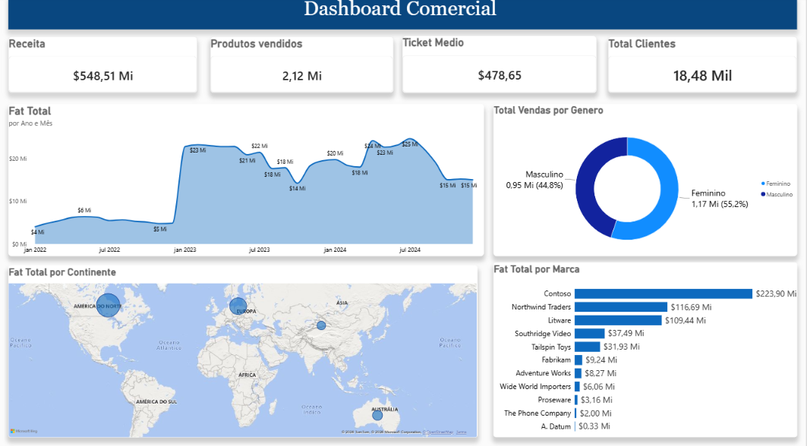

Dashboard Comercial desenvolvido com Power BI, Excel e Power Query.
# 📊 Dashboard Comercial | Power BI

## Sobre o projeto

Este projeto consiste no desenvolvimento de um Dashboard Comercial utilizando Power BI, com o objetivo de transformar dados em informações visuais que auxiliem na análise de desempenho comercial e na tomada de decisões.

Este é meu segundo projeto prático na jornada de aprendizado em Análise de Dados e Business Intelligence.

A base de dados utilizada é hipotética, proveniente de um exercício de aprendizagem da Hashtag Treinamentos.

## 🛠️ Ferramentas utilizadas

- **Microsoft Excel:** exploração e organização dos dados.
- **Power Query:** tratamento, limpeza, correção e transformação dos dados.
- **Power BI:** criação de indicadores, cálculos e visualizações interativas.

## 📈 Indicadores desenvolvidos (KPIs)

- Receita total;
- Produtos vendidos;
- Ticket médio;
- Total de clientes;
- Faturamento por período;
- Vendas por gênero;
- Faturamento por continente;
- Faturamento por marca.

## 🖥️ Visualização do Dashboard

## 🎯 Objetivo e aprendizado

Colocar em prática os conhecimentos adquiridos nos estudos de Excel, Power Query e Power BI, desenvolvendo habilidades de tratamento de dados, construção de indicadores e visualização de informações.

O projeto representa mais uma etapa da minha evolução profissional na área de Análise de Dados e Business Intelligence.

---

**Autor:** Lázaro Soares  
**Área de estudo:** Análise de Dados | Business Intelligence
